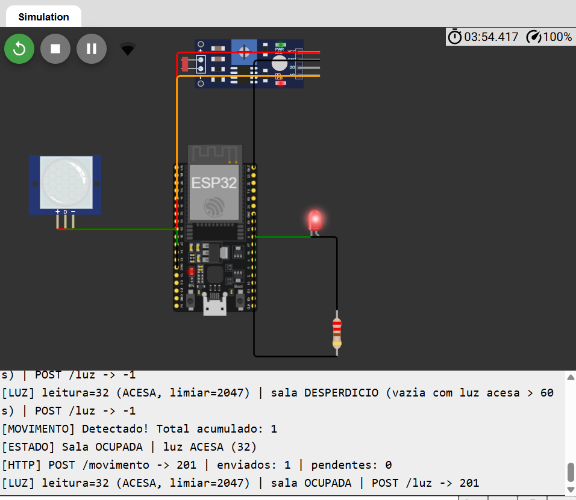
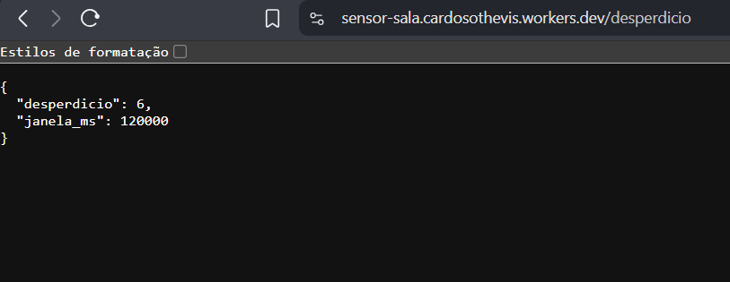
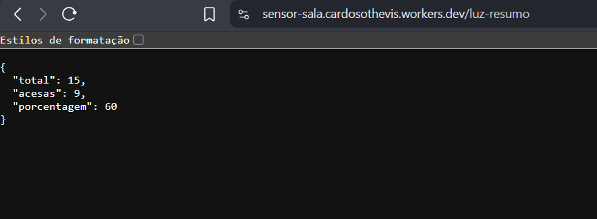
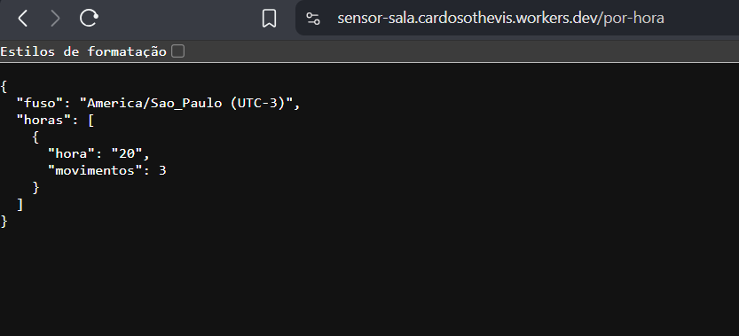
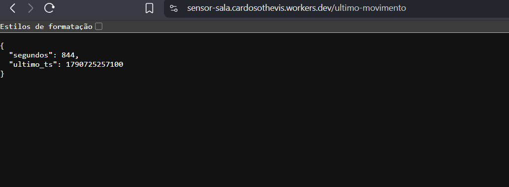
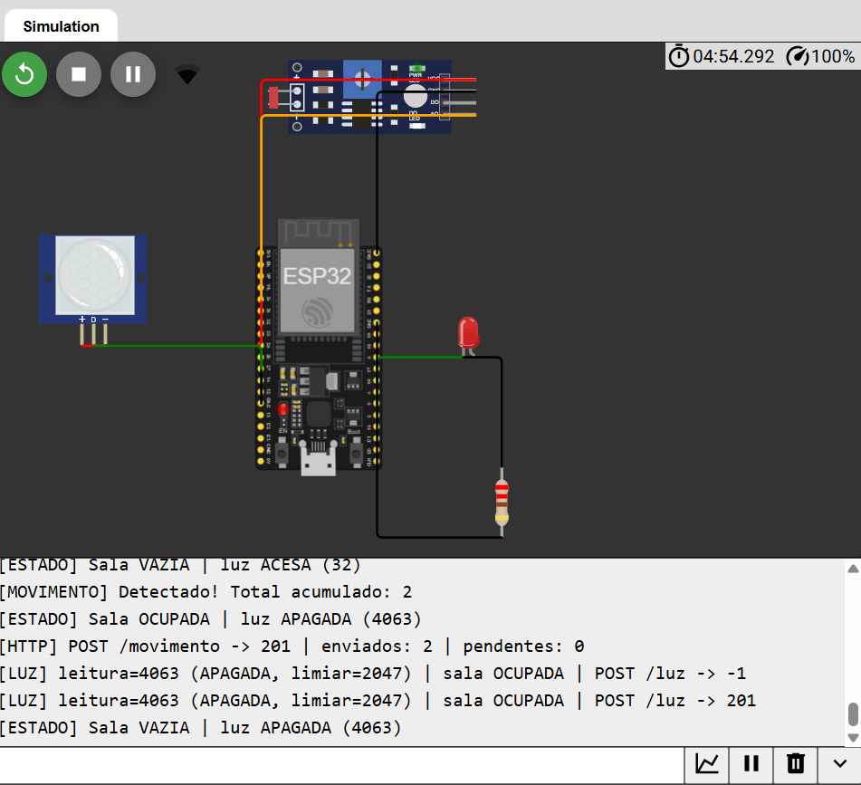
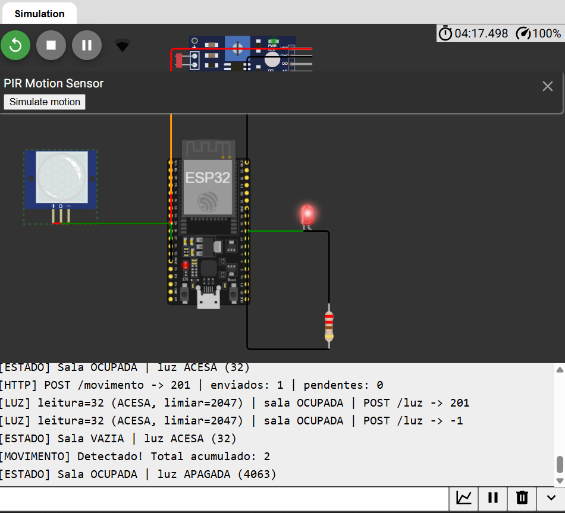
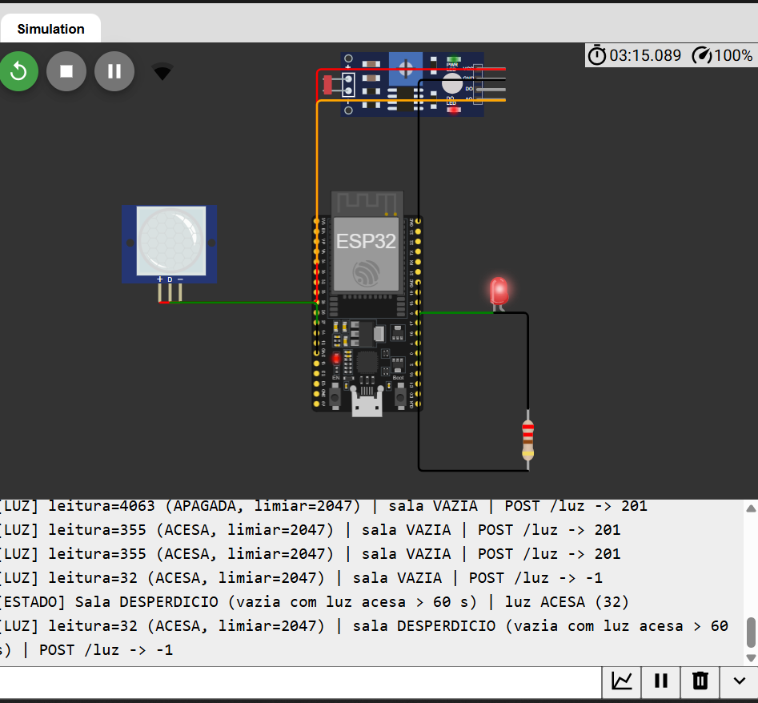

# Sensor de Ocupação e Desperdício de Luz

Projeto IoT com **ESP32** (simulado no [Wokwi](https://wokwi.com)) que detecta presença em uma sala e monitora se a luz ficou acesa sem ninguém. Os eventos são enviados via HTTPS para um **Cloudflare Worker**, que grava tudo em um banco **Cloudflare D1** (SQLite) e expõe endpoints de consulta.



## Como funciona

```
PIR (GPIO 27) ─┐
LDR (GPIO 34) ─┼─► ESP32 ──HTTPS/JSON──► Cloudflare Worker ──► D1 (SQLite)
LED (GPIO 2)  ◄┘
```

- **PIR** dispara uma interrupção (`RISING`) a cada movimento; a ISR só incrementa um contador — o envio HTTP acontece no `loop()`, sem perder eventos.
- **LDR** é lido continuamente e comparado com um limiar calibrado (ponto médio entre luz alta e baixa).
- **Estados da sala:**
  | Estado | Regra | LED |
  |---|---|---|
  | `OCUPADA` | movimento nos últimos 30 s | aceso |
  | `VAZIA` | sem movimento há 30 s | apagado |
  | `DESPERDICIO` | vazia **e** luz acesa por mais de 60 s | piscando |
- A cada movimento → `POST /movimento`. A cada 20 s → `POST /luz` com a leitura atual. Envios que falham são reenviados.

## Hardware (Wokwi)

| Componente | Pino ESP32 |
|---|---|
| Sensor PIR (OUT) | GPIO 27 |
| Módulo LDR (AO) | GPIO 34 |
| LED + resistor 220 Ω | GPIO 2 |

O circuito completo está em [`diagram.json`](./diagram.json).

## Estrutura

| Arquivo | Descrição |
|---|---|
| `sketch.ino` | Firmware do ESP32 |
| `diagram.json` | Circuito do Wokwi |
| `worker.js` | API no Cloudflare Worker |
| `schema.sql` | Tabelas do banco D1 |
| `imagens/` | Prints da simulação e das rotas |

## API

| Método | Rota | Descrição |
|---|---|---|
| `POST` | `/movimento` | Registra um movimento (timestamp gerado no servidor) |
| `POST` | `/luz` | Registra leitura de luz — corpo: `{"valor": 0-4095, "acesa": 0\|1}` |
| `GET` | `/ultimo-movimento` | Segundos desde o último movimento |
| `GET` | `/por-hora` | Quantidade de movimentos por hora (UTC-3) |
| `GET` | `/luz-resumo` | Total de leituras, quantas com luz acesa e porcentagem |
| `GET` | `/desperdicio` | Leituras com luz acesa sem movimento nos 2 min anteriores |

**Códigos HTTP:** `201` inserção OK · `200` consulta OK · `400` JSON/valor inválido · `404` rota inexistente ou sem dados · `405` método não permitido · `500` erro interno.

## Como rodar

### 1. Banco D1
1. No painel da Cloudflare, crie um banco D1.
2. Execute o conteúdo de [`schema.sql`](./schema.sql) no console do banco.

### 2. Worker
1. Crie um Worker e cole o conteúdo de [`worker.js`](./worker.js).
2. Em **Settings → Bindings**, adicione o banco D1 com o nome de variável **`DB`**.
3. Publique e anote a URL (`https://<seu-worker>.workers.dev`).

### 3. ESP32 no Wokwi
1. Crie um projeto ESP32 no Wokwi e substitua `sketch.ino` e `diagram.json`.
2. Em `sketch.ino`, troque `WORKER_URL` pela URL do seu Worker (sem barra no final).
3. **Calibração (opcional):** defina `MODO_CALIBRACAO = true`, mova o lux do LDR para o máximo e mínimo, anote os valores do Serial e preencha `LEITURA_LUZ_ALTA` / `LEITURA_LUZ_BAIXA`.
4. Inicie a simulação e acompanhe o Serial Monitor.

## Prints

| Rota | Resultado |
|---|---|
| `/desperdicio` |  |
| `/luz-resumo` |  |
| `/por-hora` |  |
| `/ultimo-movimento` |  |

Simulação:





## Segurança

- Nenhuma credencial fica no código: o Wi-Fi é o `Wokwi-GUEST` (público) e o Worker acessa o D1 apenas via binding.
- Erros internos são registrados nos logs do Worker e **não** são devolvidos ao cliente.
- A API não tem autenticação — adequada para fins didáticos. Em produção, proteja as rotas `POST` com um token (ex.: header `Authorization` guardado como *secret* do Worker).
